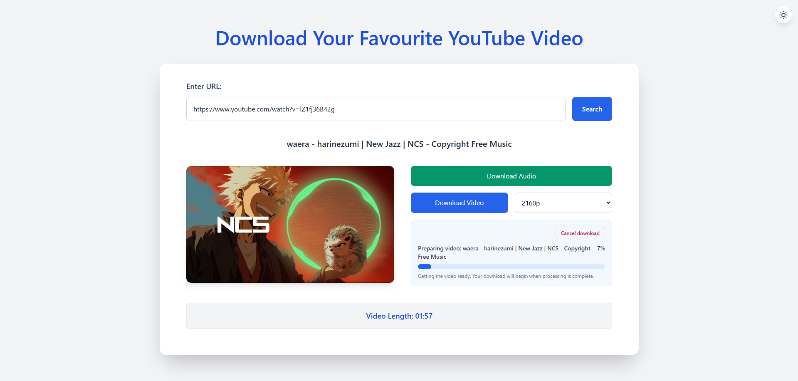
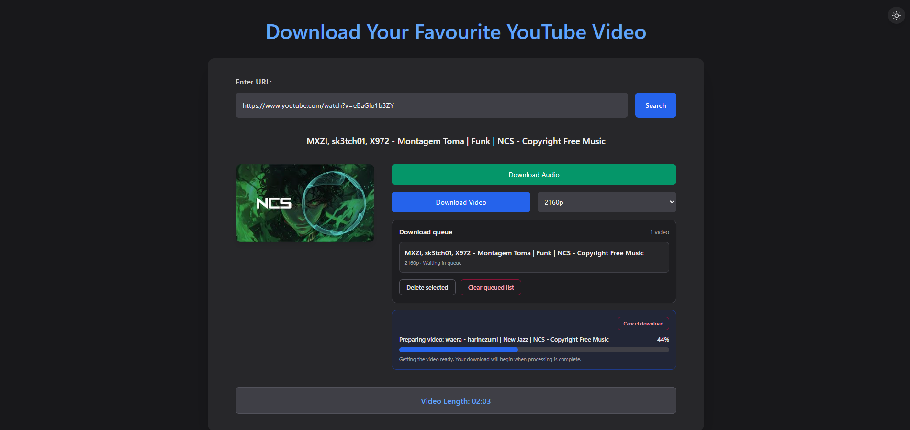

# 📥 YouTube Video Downloader Web App

A simple and user-friendly web application that allows you to download YouTube videos in your preferred resolution.

---

### ⚖️ Legal Disclaimer

> 🚫 **This project is intended for educational and personal use only.**
>
> Downloading videos or audio from **YouTube** using this tool may violate [YouTube's Terms of Service](https://www.youtube.com/t/terms) and/or **copyright laws**.
>
> The developer of this project does **not** support or encourage the downloading of copyrighted content from YouTube without permission from the content owner.
>
> This tool is provided **as-is**, with **no warranty** of any kind. Use it **at your own risk**.
>
> By using this project, you agree to take full responsibility for how you use it and to comply with all applicable laws and platform policies.
>
> 📌 **Note:** This project is **not affiliated with**, **endorsed by**, or **sponsored by YouTube** or Google Inc.

---

## 🖥️ Compatibility Note

This guide is written specifically for **Windows** systems. Compatibility with other operating systems has not been tested directly. However, you can run this script on any OS using Docker — refer to the Docker section in this README for instructions.

---

## ⚙️ Installation

### Prerequisites (Manual Setup)

- Python 3.7+ (Install from [python.org](https://www.python.org/downloads/))
- FFmpeg (Install from [ffmpeg.org](https://ffmpeg.org/download.html) and add it to your system's environment variables)

### 🧱 Create a Virtual Environment

Create a Python virtual environment inside your project folder:

```bash
python -m venv venv
```

#### Activate it:

**Windows (PowerShell):**

```powershell
venv\Scripts\Activate
```

**macOS/Linux:**

```bash
source venv/bin/activate
```

You'll know it's active when your terminal prompt starts with `(venv)`.

### 📦 Install Dependencies

Once the virtual environment is active, install all required packages:

```bash
pip install -r requirements.txt
```

### 🚀 Running the App (Manual)

1. Open Command Prompt or Terminal in the project directory.
2. Run the Flask app:

```bash
python app.py
```

3. Open your web browser and go to: `http://localhost:5000/`

---

### 📅 Docker Setup (Alternative Method)

If you prefer using Docker, you can containerize and run the app easily.

#### Step 1: Build the Docker Image

From the root directory containing the `Dockerfile`, run:

```bash
docker build -t youtube-downloader .
```

#### Step 2: Run the Docker Container

```bash
docker run -d -p 5000:5000 youtube-downloader
```

Then open your browser and navigate to:

```
http://localhost:5000/
```

> Make sure Docker is installed and running on your machine. You can download it from [docker.com](https://www.docker.com/).

---

## Code Formatting, Linting, and Type Checks

Run these commands from the repository root with your Python virtual environment active.

### Install the tools

~~~bash
python -m pip install black flake8 mypy
~~~

### Format your code and run the CI checks

Apply Black formatting before committing:

~~~bash
black .
~~~

The GitHub workflow checks formatting with:

~~~bash
black --check .
~~~

The lint and type-check workflows run:

~~~bash
flake8 .
mypy .
~~~

Flake8 and mypy report issues but do not automatically fix them. Fix their findings, then rerun the checks.

## 🛠️ Tech Stack

**Frontend:** HTML, Tailwind CSS, JS

**Backend:** Flask, Python 3.7+

**Libraries:**

- pytubefix - YouTube stream extraction
- ffmpeg-python - Video processing with FFmpeg
- flask - Web framework

---

## 📸 Screenshots




---

## 🤝 Contributing

We welcome contributions to help improve this project! Whether you're fixing bugs, improving documentation, or suggesting new features, your efforts are appreciated.

### 🚀 Getting Started

To contribute, follow the steps below:

1. **Fork the Repository**

   ```bash
   git clone https://github.com/Jienniers/YoutubeDownloaderWebApp.git
   cd Youtube-Video-Downloader
   ```

2. **Create a New Branch**
   Always create a new branch for your work to keep your changes organized and separate from the main branch:

   ```bash
   git checkout -b your-feature-branch-name
   ```

3. **Make Your Changes**
   - Ensure your code follows the existing code style.
   - Comment your code where necessary.
   - Update or add documentation if needed.

   Before committing, format your changes and run the same checks as GitHub Actions from the repository root:

   ~~~bash
   black .
   black --check .
   flake8 .
   mypy .
   ~~~

   Black applies formatting; Flake8 and mypy findings need to be fixed manually. See the Code Formatting, Linting, and Type Checks section above for details.
4. **Stage and Commit Your Changes**

   ```bash
   git add .
   git commit -m "Add: Short description of your change"
   ```

5. **Push to Your Fork**

   ```bash
   git push origin your-feature-branch-name
   ```

6. **Open a Pull Request**
   - Go to the original repository on GitHub
   - Click on "Compare & pull request"
   - Provide a clear title and description for your pull request

---

## 🛠️ Support & Issues

If you encounter any bugs, have questions, or would like to suggest new features:

- 👉 Head over to the [Issues](../../issues) tab in this repository
- 🐛 Click on **"New Issue"** to report a bug or share your suggestion
- 📋 Please include as much detail as possible:
  - Steps to reproduce the issue (if it's a bug)
  - Expected vs actual behavior
  - Screenshots (if helpful)

Your feedback helps improve this project and is always appreciated!

> 🙏 Thank you for taking the time to contribute or report issues!

---

## 📄 License

This project is licensed under the [MIT License](LICENSE).

---

## 👤 Author

- Developed by [@Jienniers](https://github.com/Jienniers)

Feel free to ⭐ the repository if you find it useful!
